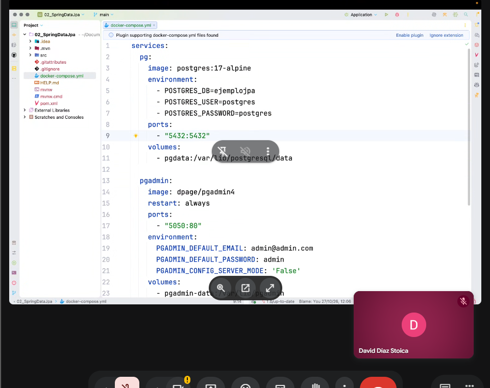
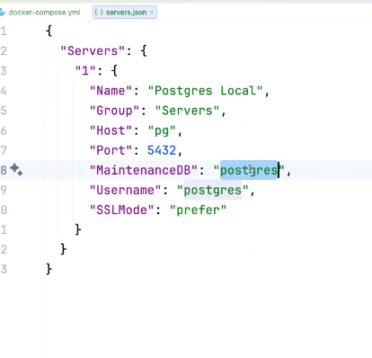
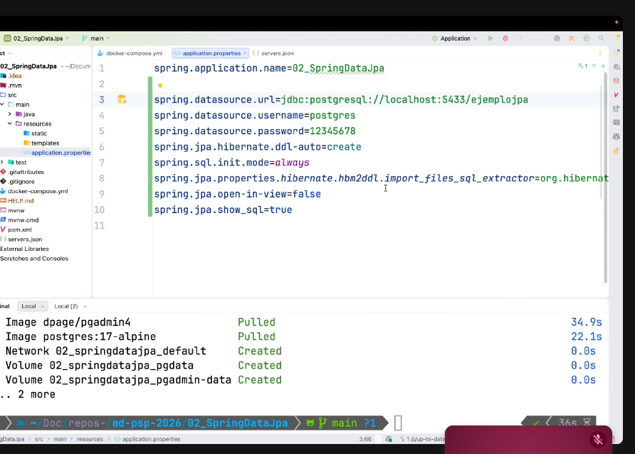
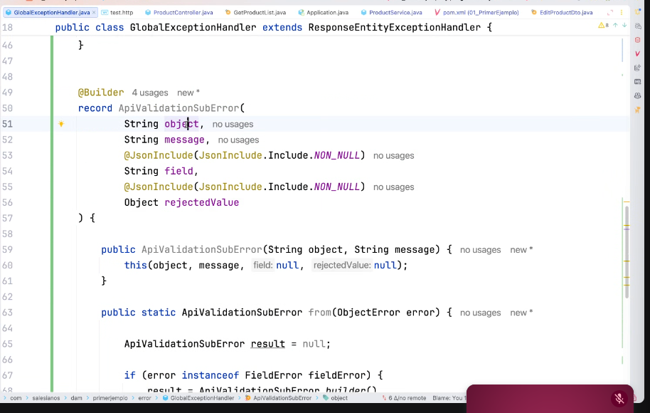
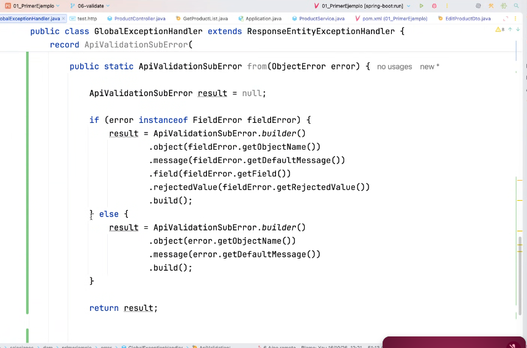
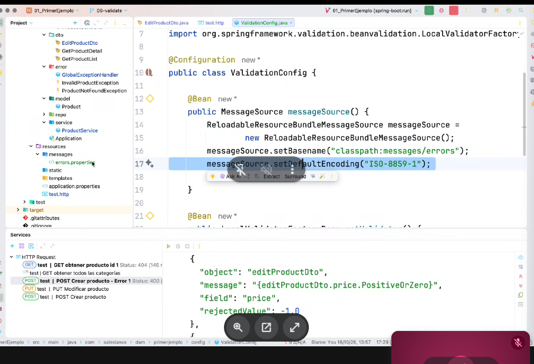
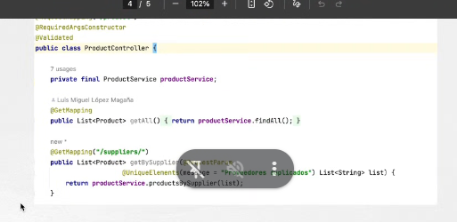
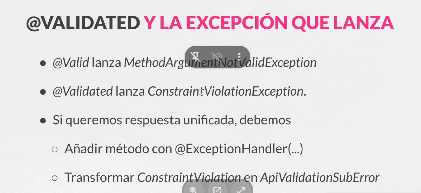

# Validaciones

> Documento paralelo generado a partir de tus apuntes y de las capturas (el original no se toca).
> Sin marca = tal cual tus apuntes (solo con la ortografía corregida) · ✏️ rehecho o corregido · ➕ añadido para completar · ❓ pendiente de confirmar

## 1. Para qué validar y en qué capa

Las validaciones sirven para cumplir los requisitos que nosotros establezcamos sobre los datos.

Se pueden realizar en cualquier capa, pero aplicarlas en todas las capas es multiplicar el trabajo.

El esquema de capas del laboratorio:

➕ Cómo leerlo: el cliente llama a la capa de presentación, esta a la de negocio, esta a la de acceso a datos y esta a la base de datos. En cada paso podría haber una validación propia (las flechas de "Custom Validation"). En este laboratorio la hacemos **antes de la capa de negocio**, en las entradas del cliente, es decir, en la capa de presentación (controlador y DTO).

**¿Por qué en esta capa?** Si validamos las entradas del cliente y nuestras reglas de negocio están bien implementadas, normalmente no necesitamos más validación.

➕ Idea práctica: lo que se valida aquí es la forma del dato (que venga, que no esté vacío, que sea positivo, que no tenga duplicados). Las reglas de negocio de verdad (que el producto exista, que haya stock...) siguen viviendo en el servicio.

## 2. Dependencia

Para comenzar hay que añadir la dependencia `validation`.

✏️ Antes: "esto hace que hibernate se encargue de validar".
Ahora: la dependencia trae la API estándar de Jakarta Validation (las anotaciones) y Hibernate Validator, que es la implementación que las ejecuta. Hibernate Validator además añade anotaciones propias que no son del estándar y se importan de otro paquete.

**Documentación:**

- [Hibernate Validator](https://docs.hibernate.org/validator/9.2/api/org/hibernate/validator/constraints/package-summary.html)
- [Jakarta Validation](https://jakarta.ee/specifications/bean-validation/4.0/apidocs/jakarta.validation/module-summary.html)

## 3. Anotaciones típicas (Jakarta EE)

| Anotación | Qué comprueba |
|---|---|
| `@NotNull` | El campo no puede ser nulo. Ojo: una cadena vacía `""` sí pasa. |
| `@NotEmpty` | No puede ser nulo ni estar vacío (cadenas, colecciones, mapas, arrays). Una cadena de solo espacios sí pasa. |
| `@NotBlank` | Solo para cadenas: no nulo y con al menos un carácter que no sea espacio. |
| `@Min`, `@Max` | El valor numérico no puede ser menor que el mínimo / mayor que el máximo. |

✏️ La diapositiva dice "por debajo/encima" en el orden `@Min`, `@Max`, y está al revés: `@Min` exige estar **por encima o igual** al valor, y `@Max` **por debajo o igual**.

➕ Dos más que aparecen en tus capturas:

- `@PositiveOrZero`: el número debe ser 0 o positivo. Es la que rechaza el precio `-1.0` en la petición de prueba.
- `@UniqueElements`: la colección no puede tener elementos repetidos. Esta es de **Hibernate**, no de Jakarta, y se usa en el ejemplo del controlador (apartado 6).

Las validaciones pueden combinarse y concretar el error.

## 4. Cómo se representa un error: el record `ApiValidationSubError`

La validación de un objeto puede dar un fallo o más de uno, así que lo que se devuelve al cliente es una lista de errores, y cada error se modela con un record.

Como no vamos a usar el record fuera de esta clase, se crea un **record local** dentro de `GlobalExceptionHandler` (que hereda de `ResponseEntityExceptionHandler`, la clase de Spring que ya trae manejadores para las excepciones típicas de MVC).

Qué tiene el record:

- `object`: el nombre del objeto validado (en tu captura, `editProductDto`).
- `message`: el mensaje de error.
- `field`: el campo que falló.
- `rejectedValue`: el valor que se rechazó.
- `field` y `rejectedValue` llevan `@JsonInclude(NON_NULL)`: si valen `null`, **no aparecen en el JSON**. Así un error a nivel de objeto sale sin esos dos campos.
- Un segundo constructor que solo recibe `object` y `message` y rellena los otros dos con `null`, pensado para esos errores a nivel de objeto.
- `@Builder` permite construirlo paso a paso, que es lo que usa el método `from`.

➕ Esto responde a tu nota "esta validación se aplica a un campo del dto, pero aprenderemos a nivel dto": el método `from` distingue los dos casos.

`from` recibe un `ObjectError` de Spring y devuelve un `ApiValidationSubError`:

1. Si el error es un `FieldError` (un `FieldError` es un tipo de `ObjectError`, por eso se comprueba con `instanceof`), el fallo es de un **campo concreto**: se rellenan los cuatro datos (nombre del objeto, mensaje, campo y valor rechazado).
2. Si no, es un error **a nivel de DTO** (afecta al objeto entero): solo se rellenan objeto y mensaje.

➕ Lo que verías en el cliente para el caso del campo (de tu captura de la petición): objeto `editProductDto`, campo `price`, valor rechazado `-1.0`.

❓ Punto a vigilar: en esa misma captura el mensaje sale como `{editProductDto.price.PositiveOrZero}`, es decir, la **clave** entre llaves y no el texto. Eso suele significar que esa clave no se ha encontrado en el fichero de mensajes, o que el validador todavía no estaba conectado a ese fichero. Mira el apartado 5 para revisarlo.

➕ Mejora opcional: `result` se inicializa a `null`, pero los dos caminos del `if/else` lo asignan siempre, así que ese `null` inicial no hace falta.

## 5. Mensajes de error

Los mensajes pueden estar en tres sitios:

1. En la propia validación: `@NotBlank(message = "Nombre no puede estar en blanco")`
2. En una clase nueva que centralice todos los mensajes.
3. En un fichero de propiedades (`errors.properties`).

✏️ Antes dudábamos de qué `@Bean` era. Con tu captura queda claro: es una clase de configuración (`ValidationConfig`, con `@Configuration`) con dos beans:

- **`MessageSource`** (`ReloadableResourceBundleMessageSource`): le dice dónde están los mensajes.
  - `setBasename("classpath:messages/errors")`: el fichero está en `src/main/resources/messages/errors.properties`. En el nombre base no se escribe la extensión. Con idiomas, se añade el sufijo: `errors_es.properties`, `errors_en.properties`...
  - `setDefaultEncoding("ISO-8859-1")`: la codificación con la que se lee el fichero. Tiene que coincidir con la del fichero real, o las tildes y la ñ saldrán rotas.
- **`LocalValidatorFactoryBean`** (el segundo `@Bean`, que la captura deja cortado): normalmente es el que conecta el validador con ese `MessageSource`.
  ❓ Confirma en tu código que lo hace.

➕ Cómo se usa: en la anotación se pone la clave entre llaves (como `{editProductDto.price.PositiveOrZero}`) y el texto se busca en el fichero. Si la clave no existe en el fichero, el mensaje sale con las llaves, justo lo que viste en la captura.

**Locale:** en Java hay un objeto, `Locale`, que identifica la localización. Está conectado con monedas, hora y formatos de distintos países. Según el `Locale` se elige un fichero de mensajes u otro, así puedes tener los errores en español y en inglés sin tocar el código.

## 6. @Valid y @Validated

✏️ Antes: "`@Valid` no es lo mismo que `@Vaidate`". El nombre correcto es `@Validated`.

- `@Valid` es de Jakarta (el estándar). Valida el objeto y baja a los objetos anidados.
- `@Validated` es de Spring. Hace lo mismo para el objeto y además permite **grupos de validación** (reglas distintas para crear y para actualizar) y, puesto a nivel de clase, activa la validación de parámetros simples de los métodos.

➕ Qué muestra la captura: `ProductController` tiene `@Validated` **en la clase**. Un método de `/suppliers/` recibe una lista de proveedores como parámetro con `@UniqueElements(message = "Proveedores duplicados")`. Como es un parámetro simple y no un objeto del cuerpo, quien lo valida es el `@Validated` de la clase.

## 7. Excepciones y respuesta unificada

- `@Valid` lanza `MethodArgumentNotValidException`.
- `@Validated` lanza `ConstraintViolationException`.
- Si queremos una respuesta unificada hay que:
  1. Añadir un método con `@ExceptionHandler(...)` para cada excepción.
  2. Transformar cada `ConstraintViolation` en un `ApiValidationSubError`.

➕ Las tres piezas, para no confundirlas:

- **`ConstraintViolation`** (sin "Exception"): *un* fallo concreto, con campo, valor, regla incumplida y mensaje.
- **El conjunto de violaciones**: lo que devuelve el validador si lo usas a mano. Vacío = todo correcto, y no salta ninguna excepción.
- **`ConstraintViolationException`**: la excepción que envuelve ese conjunto cuando el framework corta la ejecución (parámetros simples con `@Validated` en la clase, o al guardar una entidad con JPA).

➕ Cuál de los dos métodos de `from` sirve para cada caso: el `from(ObjectError)` del apartado 4 sirve para `MethodArgumentNotValidException`, porque esa excepción trae errores de ese tipo. Para `ConstraintViolationException` hace falta otra conversión, que es la que pide el segundo punto de la diapositiva.

❓ Nota de versión: en Spring 6.1 o superior, un parámetro simple con restricciones en un controlador **sin** `@Validated` en la clase lanza `HandlerMethodValidationException` en vez de `ConstraintViolationException`. Comprueba la versión de Spring Boot en tu `pom.xml`: con el `@Validated` en la clase, como en tu captura, sigue saliendo `ConstraintViolationException`.

## 8. Para hacer tú

Falta la conversión de `ConstraintViolation` a `ApiValidationSubError`. Pistas, sin código:

1. Mira qué datos te da una `ConstraintViolation` (su ruta de propiedad, el valor inválido, el mensaje y la clase raíz) y empareja cada uno con uno de los cuatro campos del record.
2. Piensa qué ruta ves cuando el fallo es de un parámetro de método: no es lo mismo que la de un campo de un DTO, y puede que tengas que quedarte solo con la última parte.
3. Decide qué rellenas en `object` y qué en `field` en este caso, y comprueba con una petición con duplicados que la respuesta sale con el mismo formato que la de `price`.
4. Añade un `@ExceptionHandler` para `ConstraintViolationException` que recorra todas las violaciones y devuelva la lista.
