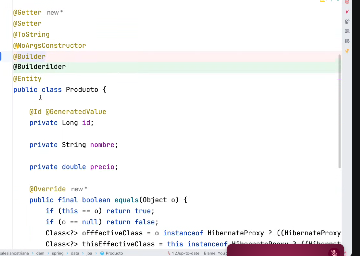
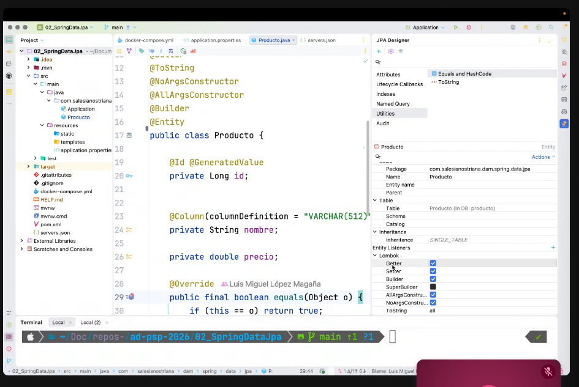
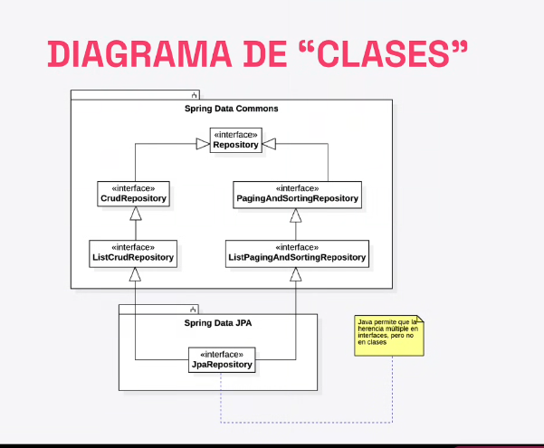

ºbgn

Añidimos la dependecía de postgres. En lugar de la de H2

El docker compose nos va a permitir orchestar más de un contendor a la vez.

Definimos cada contenedor como un servicio

los tags de las imagenes determinan versiones. Se suele utilizar alpine porque pesa menos

La interconxión por puertos

server.json es la configuracion que tiene pgAdmin de guardar los servidores a los que se va conectar:

De esta forma al conectarnos nos entrara directamente

1. Es la cadena de datos que apunta a donde nos vamos a conectar, ese localHost apunta a la bdd qe esta en docker. EL final es el nombre de la bdd

2. Spring.sql.init.mode=always; cuando no es una bdd embebida, spring te deja decidir que pas con es bdd

Modelo de dominio: Es la representación conceptual de ese entorno dentro del código, estructurada mediante clases, entidades, atributos y relaciones (muchas veces plasmada en diagramas UML) --> El dominio del problema se puede servir antes de encender un ordenador.

Domain-Driven Design, es una metodología que está relaacionada con la arquitectura limpia o en ocasiones con la hexagonal.

Spring data JPA se encarga de mapear la bdd a nuestro codigo. Por ejemplo si si hago un add, en realidad lo que hace jpa es hacer un insert

- Entidad:
  Una entidad es un conjunto de valores con id y ciclo de vida
- Valor:
  Un valor es algo que se almacena en la bdd, puede ser atommico, sin ciclo de vida propio

- equals y hashcode tienen que ser consistentes

`@Data` de lombok se puede usar pero puede dar problemas en su lugar usamos

Podemos mezclar el tipo de identificador que vamos a usar 

4 estrategías

AUTO: escoge la mejhor en fucnion del tipo de dato y el dialecto de la base de datos concreta
IDENTITY: utiliza una columna de tipo identidad (Serial postgres)
Sequence: Se utiliza una secuencia para obtener los valores
Table: Se utiliza una tabla para obtener los valores
UUID: utiliza su propio generador

A dia de hoy con sistemas que van a tener muchos cambios, identity no es adecuado.

## Anotaciones: 

`@Basic`casi que no la vamos a usar 

`@Table`Sirve para personalizar la tabla enla bdd

`@Column` Hace referencia a una columan en la bdd, la usaremos más a menudo. Permite realizar cambios. 

flyway y liquidbase

Desde ese panel se puede gestioanr

## Repositoríos JPA. 

Da igual que la bdd sea relacional o no relacional

En este momento aprece la herencia multiple. Aqui hereada tanto de listPagingRepository como de CrudRepository

**JAVA si permite que una interfaz here de varías interfaces** pero con clase no. 

Los JPA necestia que le digamos dos tipos de datos. EL tipo y el tipo del id. 

ºend
